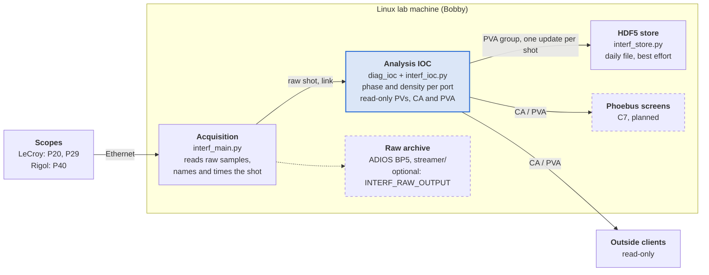
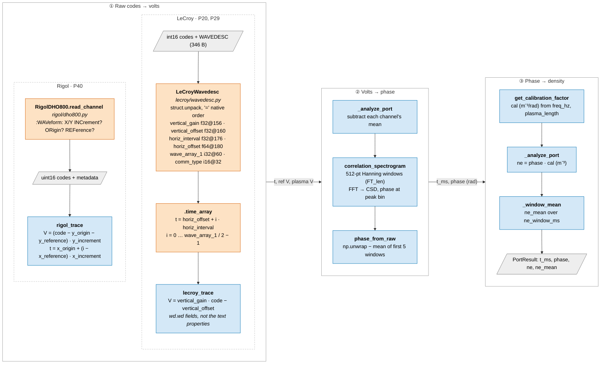

# bapsf_interferometer

Acquisition and live analysis for the BaPSF microwave interferometers at ports 20, 29 and 40: line-integrated plasma density, shot by shot, published to EPICS.

> **Refactor in progress** on branch `refactor/linux-epics-daq`



## How a shot flows

1. **Acquisition** ([interf_main.py](interf_main.py), [interf_raw.py](interf_raw.py)) waits for a LeCroy trigger, reads both scopes (the Rigol is triggered by the LeCroy, so both hold the same shot), and gives the shot an ID: its Los Angeles date plus a number from 0 each day, timed by the LeCroy trigger (host time when there is none). It computes no phase and never waits on what comes after it.
2. **The link** ([diag_ioc/link.py](diag_ioc/link.py)) sends the raw shot to the IOC. It is latest-wins: if the IOC is slow or down, shots are dropped, never queued up behind acquisition; an outage is logged with the shots not delivered.
3. **The IOC** ([interf_ioc.py](interf_ioc.py), on the [diag_ioc/](diag_ioc/) host) runs `analyze_shot` ([interf_analysis.py](interf_analysis.py)) and publishes phase and density for each port under `LAPD:DIAG:INTERF`. Every PV of a shot carries the shot's timestamp, and the PVA group `LAPD:DIAG:INTERF:SHOT` delivers the whole shot as one update.
4. **The HDF5 store** ([interf_store.py](interf_store.py)), a separate process, subscribes to that group and writes each shot to `interferometer_data_<YYYY-MM-DD>.hdf5`, in the same layout the previous acquisition wrote.

A port without data (channel off or flat, Rigol down) is published as missing with its reason, never as zeros. The live path is best effort: the raw archive is meant to be the complete record (D9 in [ARCHITECTURE.md](docs/ARCHITECTURE.md)).

## Quick start

Python 3.11 or later (developed on 3.14). Acquisition runs on **Linux only**. `pip install .` installs the dependencies, including [`lab-scopes`](https://github.com/hjia94/lab_scopes) `v0.4.2`, the scope drivers.

```bash
pip install -e '.[ioc,clients]' -c constraints.txt                  # IOC and store extras; constraints.txt pins the EPICS stack
python -m diag_ioc --config my_interferometer.toml                  # analysis IOC; a copy of deploy/diag-ioc/interferometer.toml
INTERF_IOC_LINK=unix:/run/diag-ioc/interferometer/link.sock LECROY_IP=<address> python interf_main.py   # acquisition
python -m interf_store --prefix LAPD:DIAG:INTERF                    # HDF5 store
python -m interf_sim --limit 20                                     # no scopes: replay recorded .trc files
```

In production the IOC, acquisition and the store run as systemd units from [deploy/systemd/](deploy/systemd/) under the `diag-ioc` account: `diag-ioc@.service` (one IOC per `/etc/diag-ioc/<name>.toml`), `interf-acquire.service` (with `acquire.env.example`) and `interf-store.service`. Install steps are in each unit's header.

## Where to look

| To learn about | Read |
|---|---|
| Running acquisition, its log lines, every environment variable, the `RawShot` it returns | [docs/ACQUISITION.md](docs/ACQUISITION.md) |
| The IOC (config, PV behavior, timing log), the `diag_ioc` package, the HDF5 store | [docs/LIVE_IOC.md](docs/LIVE_IOC.md) |
| The daily HDF5 file layout, old and new | [docs/HDF5_FORMAT.md](docs/HDF5_FORMAT.md) |
| Testing without scopes: `.trc` replay, synthetic shots, the link listener | [docs/SIMULATION.md](docs/SIMULATION.md) |
| Why it is built this way, and the PV list (D4) | [docs/ARCHITECTURE.md](docs/ARCHITECTURE.md) |
| What is done and what is next, commit by commit | [docs/HANDOFF_live_epics.md](docs/HANDOFF_live_epics.md) |

## Code map

| Path | Role |
|---|---|
| [interf_main.py](interf_main.py) | Acquisition entry point: loop, logging, Ctrl-C/SIGTERM handling |
| [interf_raw.py](interf_raw.py) | Same-shot raw read from the LeCroy and the Rigol |
| [interf_shot.py](interf_shot.py) | Shot time (LeCroy trigger, Los Angeles zone, host-time fallback) and the per-day shot counter |
| [interf_analysis.py](interf_analysis.py) | Phase extraction (`phase_from_raw`, cross-spectral density; `phase_from_hilbert`, slower), calibration, `analyze_shot` |
| [interf_payload.py](interf_payload.py) | Live-link message of one shot (`encode`, `decode`) |
| [interf_png.py](interf_png.py) | Optional CA monitor of PNG's run and shot numbers, copied into each raw shot (D16) |
| [diag_ioc/](diag_ioc/) | Generic diagnostic IOC host (pythonSoftIOC) and the acquisition-to-IOC link |
| [interf_ioc.py](interf_ioc.py) | The interferometer's IOC module: link message → `analyze_shot` → PVs and the `SHOT` group |
| [interf_store.py](interf_store.py) | HDF5 store, a PVA client of the `SHOT` group |
| [interf_file.py](interf_file.py) | HDF5 schema and writers |
| [interf_archive.py](interf_archive.py) | Reads the ADIOS raw archive back for offline reanalysis with `analyze_shot` |
| [interf_sim/](interf_sim/) | Offline simulation: `.trc` replay, synthetic shots, a development link listener |
| [streamer/](streamer/) | ADIOS/socket raw output; maintained by another group, not edited here |
| [deploy/](deploy/) | Production IOC config, read-only access file, systemd units |
| [constraints.txt](constraints.txt) | Exact versions of the EPICS stack (`softioc`, `epicscorelibs`, `pvxslibs`, `p4p`, `pyepics`), for `pip install -c` |
| [tests/](tests/) | `python -m unittest discover -s tests -v` |

The live GUI will be re-implemented under EPICS (Phoebus, C7). The HDF5 readers and the datarun merge scripts may return later on this branch.

## From raw codes to phase and density

`analyze_shot` runs this once per port: P20 and P29 come from the LeCroy, P40 from the Rigol. Read left to right. Box colors give the file: **orange** is the [`lab-scopes`](https://github.com/hjia94/lab_scopes) package (`src/lab_scopes/`), **blue** is [interf_analysis.py](interf_analysis.py), and grey slanted boxes are data.


